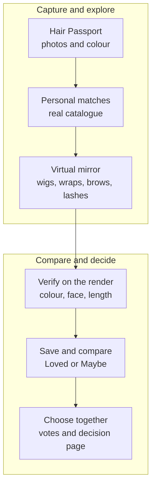
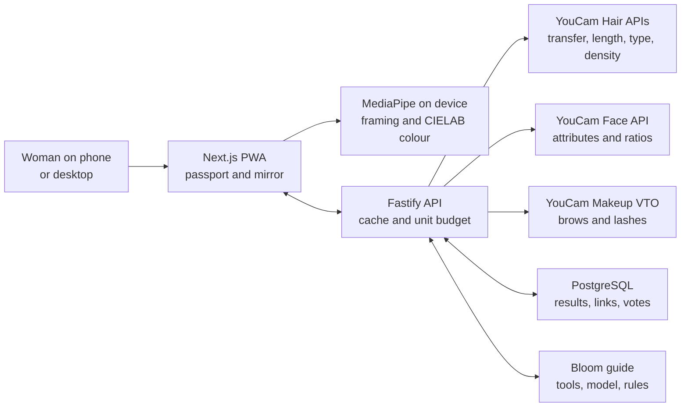

# Bloom: Choose your hair before treatment does.

**“I did not know the stranger looking back at me from the mirror.”** Those are the words of Renita, a woman who [shared her experience of chemotherapy-related hair loss with Macmillan Cancer Support](https://community.macmillan.org.uk/cancer-blogs/b/community_news/posts/i-did-not-know-the-stranger-looking-back-at-me-from-the-mirror--renita-s-hair-loss-story). After losing her hair, eyebrows, and eyelashes, she wore a wig and drew on her brows for Christmas with her family. For a few hours, she said, she felt more like her old self.

**We built Bloom for moments like that, and for the chance to prepare before they arrive.** Bloom turns a photo of someone's natural hair into a **Hair Passport**, finds real wigs that resemble it, lets her try wigs, head wraps, brows, and lashes on her own face, then checks the generated result and helps her choose with people she trusts. It is one connected journey from **“this is my hair”** to **“this is my choice.”**

**See Bloom in action.** This recording uses a sample face and genuine pre-rendered YouCam results, so anyone can explore the experience without uploading a photo.

## Inspiration

- **A choice before hair loss.** [Writer Judith Harris described shopping for a wig with her sister and a hairstylist after her first chemotherapy session](https://washingtonian.com/2009/12/01/first-person-will-it-grow-back/). She still had her own hair, but the experience was already changing how she saw herself. Her account showed us why the preparation window, personal reference photos, and trusted opinions belong in one experience.

- **The options must reflect the person.** [Dianne Austin, a Black breast cancer survivor, could not find a wig like her tightly coiled hair at nearby hospitals](https://blog.dana-farber.org/insight/2025/01/breast-cancer-survivor-provides-textured-wig-options-to-women-of-color/). Her experience, and the textured-wig company she later founded with her sister, made representation a concrete priority for Bloom's planned catalogue expansion. A [review of 11 qualitative studies involving 225 women](https://pubmed.ncbi.nlm.nih.gov/36973593/) also found that treatment-related hair loss can deeply affect body image and identity.

- **A personal decision in a short window.** A wig, a wrap, or neither should be her choice. The [American Cancer Society recommends photographing natural hair](https://www.cancer.org/cancer/managing-cancer/side-effects/hair-skin-nails/hair-loss/choosing-and-wearing-wig) when someone wants to match its style or colour, and [Breastcancer.org recommends preparing before treatment](https://www.breastcancer.org/treatment-side-effects/hair-loss/wigs) when a wig is something they may want. We turned that advice into a Hair Passport she can keep, use for matching, and take to a wig fitter.

### The need in numbers

- **One study shows why the window and the whole face matter.** In a [survey of 1,478 breast cancer patients treated at 47 sites in Japan](https://journals.plos.org/plosone/article?id=10.1371%2Fjournal.pone.0208118), hair loss began an average of **18 days** after chemotherapy started. **84%** used a wig during or after treatment, while **90%** lost eyebrow hair and **88%** lost eyelash hair. These figures describe patients who received anthracycline and/or taxane chemotherapy; each person's experience can differ.

- **The product follows the evidence.** The short preparation window shaped our capture flow. Wigs require a real catalogue and an actual mirror experience; brow and lash loss mean the fitting room must look at the whole face. Bloom puts these choices in one place, with a working sample journey judges can explore immediately.

## What it does

- **A complete experience, not separate demos.** From Hair Passport to real-product matches, realistic try-on, visible measurements, saved looks, family feedback, and a decision page, each step leads naturally to the next. The GIFs below show additional parts of the working browser experience.

- **Make a Hair Passport.** A guided camera or upload flow records a front photo, with optional side and top photos. MediaPipe checks framing and measures natural hair colour on the device. YouCam analysis adds face attributes and, when the relevant photos are available, hair length, type, and density. The passport shows where each reading came from; an unreadable result is left unfilled rather than guessed.

  

- **Find and try looks.** Bloom ranks real catalogue wigs against the passport and renders a selected wig or head wrap on her photo. She can also explore brows and lashes, including looks layered over a wig or wrap. The fitting-room mirror lets her compare the result with her original photo and save looks to **Loved** or **Maybe**.

- **Check the finished image.** The same on-device process that measures natural hair colour also checks the completed try-on. Bloom uses **CIEDE2000 (ΔE)**, a standard way to describe colour difference, then explains how close the result looks to her own hair. Its styling score combines colour, face-shape guidance, and rendered length at **45% / 35% / 20%**.

  

- **Choose together.** She can compare saved looks, share up to three selected looks through a seven-day family link, and see **love it / not for me** votes. Only the chosen looks go into that shared view. The Bloom guide can search the catalogue or compare saved looks using their actual layers, fit facts, and family tallies. When she chooses a wig, a printable decision page gathers the product details and practical insurance questions in one place.

  

- **Explore without a camera.** A sample Hair Passport and genuine pre-rendered YouCam try-ons let someone understand the full experience before sharing a personal photo.

  

### Personal photos, purposeful processing

**Bloom makes a clear distinction between local analysis and requested cloud processing.** The Hair Passport and saved collection live in the user's browser through **IndexedDB**. MediaPipe handles framing and hair-colour sampling on the device. When someone requests a YouCam hair, face, or beauty analysis or a virtual try-on, the selected image is sent through Bloom's backend to **YouCam** for that operation. The backend manages tasks and caches reusable results, while **PostgreSQL** supports results, family links, and votes. This is an intentional combination of on-device analysis and server-backed try-on.

**Sharing is a separate choice.** A family link displays up to three looks the user deliberately selects, rather than automatically publishing the entire passport or collection. The people who receive the link can view that chosen selection and vote during its **seven-day** lifetime. As a link-based share, access depends on possession of the link. The Bloom guide receives passport facts, product details, and saved-look IDs, **not the user's photographs**. And judges can experience the pre-rendered sample mode without a camera, an account, or a personal upload.

### The journey

## How we built it

- **Hair try-on and measurement.** **YouCam AI Hairstyle / Hair Transfer** renders wigs and wraps. **AI Hair Length Detection** reads her original photo and the completed wig render. **AI Hair Type Detection** reads optional side photos, while **AI Hair Density Detection** reads an optional top photo.

- **Face and beauty try-on.** **YouCam AI Face Attributes & Ratio Analyzer** informs face-shape and brow guidance. **AI Makeup VTO** renders brows and lashes. These six YouCam capabilities connect measurement, styling, and the finished look.

- **Colour measured twice.** MediaPipe Tasks Vision runs in the browser for face framing and hair segmentation. We convert hair pixels to **CIELAB**, take their median colour, and use **CIEDE2000** to compare colours. We repeat the measurement on a finished wig render. When that reading is available, the fitting room uses it in place of the product photo's colour.

- **A full stack built for the journey.** The interface is a **Next.js 16 / React 19** progressive web app. A **Fastify** API keeps YouCam credentials on the server, prepares images with **Sharp**, starts and polls YouCam tasks, and stores reusable results and family votes in **PostgreSQL**. The passport and saved collection live in browser **IndexedDB**. Caching and unit limits help manage API use.

- **A guide that can explain its choices.** The Bloom guide shows its steps as it reads the passport, searches the catalogue, checks fit, and compares saved looks. It can plan with **Groq** or **OpenRouter**, with a rule-based path available if a model is unavailable. The guide receives facts and saved-look IDs, not photos. Bloom checks its picks against the catalogue and her stated wishes.

### The engineering path

## Challenges we ran into

- **Making headwear feel like a real try-on.** We tested YouCam's hair transfer, hat, and scarf routes with wigs and wraps. Hair transfer preserved the person's face and reproduced a head wrap more faithfully for Bloom's mirror experience, so we used it for both wigs and wraps.

- **Making a colour claim we could defend.** Product photography changes with lighting and backgrounds. We measured catalogue colours and then added a second check on the rendered result. That gives Bloom a way to explain how a look reads **on the person**, using the same colour scale as her passport.

- **Keeping analysis honest.** Optional photos introduce missing data, and a visual API can reject a difficult image. We separated each analysis result, surfaced plain-language capture guidance, and showed notes when a property could not be read. The fitting room can still use the measurements that succeeded.

- **Making an agent useful within finite API and model budgets.** YouCam calls consume units, and model providers can throttle a multi-step guide. We cache identical renders, record unit use, pre-render the sample experience, validate model picks against deterministic tools, and retain a rules-based guide path.

## Accomplishments that we're proud of

- **One connected, working experience.** A woman can start with a photo, build her Hair Passport, find a matching product, see a YouCam render on her own face, check its colour and length, save and compare looks, invite family votes, and take a decision page to a fitter. Those steps work together in the app and API. The catalogue contains **11 wig styles and 2 wrap styles across 51 variants**.

- **Technical depth that serves the user.** Bloom does not stop after generating an attractive image. It ranks real products, measures the finished preview, exposes the basis of each match, and carries that information into comparison and decision-making. The six YouCam capabilities work as one product, supported by original colour maths, validated catalogue data, and an inspectable result.

- **A respectful interface.** The arched mirror links the welcoming landing page to the studio. The mobile and desktop layouts, guided capture, sample mode, comparison controls, and plain explanations aim to make a sensitive decision feel approachable. Bloom is a cosmetic shopping aid; it makes no diagnosis or treatment claim.

- **Proof beyond a polished screen.** The real-photo journey runs through the Next.js app, Fastify API, PostgreSQL, and live YouCam calls. We also built a pre-rendered sample path so judges can experience the flow immediately. Our frontend and backend tests cover matching logic, API behavior, sharing, and the main journey.

## What we learned

- **A preview should help someone decide.** A try-on image becomes more useful when she can compare it with her own hair, understand the colour and length, and find the real product behind it.

- **Personalization needs a clear source.** We learned to distinguish what a phone measured, what YouCam measured, and what a styling rule inferred. The guide can speak warmly, but its numbers and product claims must come from tools.

- **Choice is the outcome.** Some women may want a familiar wig; others may prefer a wrap, an adventurous new style, or no head covering. Bloom works best when it gives her room to decide rather than telling her what she should look like.

## Why Bloom deserves first place

- **Bloom meets the whole brief.** The [official judging criteria weigh technology, design, impact, and idea equally](https://youcam-api-skin-ai-ecommerce.devpost.com/rules). Bloom combines six purposeful YouCam integrations, original colour and matching logic, a working full-stack product, and a clear human need documented in women's own words. Its visual design and engineering both serve the moment when someone asks, "Will this still feel like me?"

- **The difference is the whole decision.** A generic virtual try-on shows a product on a face. Bloom starts with the woman's own hair, uses that record to find real products, checks the completed render, and helps her compare, ask family, and choose. The YouCam APIs are part of an end-to-end path she can use, with product details she can carry into an actual purchase.

- **Women in Tech.** **Nourin Richi is the leader of our two-person team.** She worked on the research, finding the problem, UI/UX design, planning, architecture finalization, documentation, and video editing. **Ahammad Shawki** worked as Bloom's full-stack developer and AI engineer. Nourin's leadership shaped both the human purpose of Bloom and the way people experience the finished product.

- **Rising Star.** Both teammates are currently studying at university. **Ahammad Shawki** studies at the **Bangladesh University of Engineering and Technology (BUET)** (`2305067@ugrad.buet.cse.ac.bd`). **Nourin Richi** studies at **BRAC University** (`nourin.zaman.rachi@g.bracu.ac`). Together, they took Bloom from research and design through a working PWA, API, database, YouCam pipeline, colour analysis, and grounded guide.

## What's next for Bloom

Bloom's **working PWA, live YouCam pipeline, curated catalogue, matching logic, fitting room, family comparisons, and sample demo exist today**. The next stage is about bringing this connected experience to a wider real-world audience.

- **Use the prize to take Bloom into real life.** First prize would fund our planned public pilot: dependable hosting and YouCam usage, expanded privacy controls for personal photos, and practical support for people using Bloom during treatment. Our goal is a product women can rely on long after the hackathon.

- **Make every woman more likely to find herself.** Our current catalogue is the foundation. Next, we plan to add textured and coiled hairstyles, more colours and lengths, varied budgets, cap styles, and headwear. We aim to work with wig makers and fitters so that a look in Bloom leads to an item someone can actually obtain.

- **Launch with the people who already support patients.** We plan to invite patient advocates, wig fitters, cancer support organizations, and women facing treatment into a pilot to guide the next version. Their feedback will shape accessibility, photo guidance, privacy, and buying information before a broader launch. The goal is simple: when someone like Renita wants to feel like herself in the mirror, Bloom should be there with choices she can actually use.

<!-- Devpost production note: Upload docs/assets/bloom-evidence-poster.png and all five docs/assets/devpost-gifs/*.gif files with the story, then replace the relative paths with Devpost image URLs. Export both Mermaid diagrams as images before pasting into Devpost. Use a 3:2 landscape canvas (for example 1600 x 1067 px) and at least 20 px diagram text; check legibility at typical page width. Devpost documents Markdown story formatting but does not document native Mermaid rendering. Replace each code block with its exported image. -->
