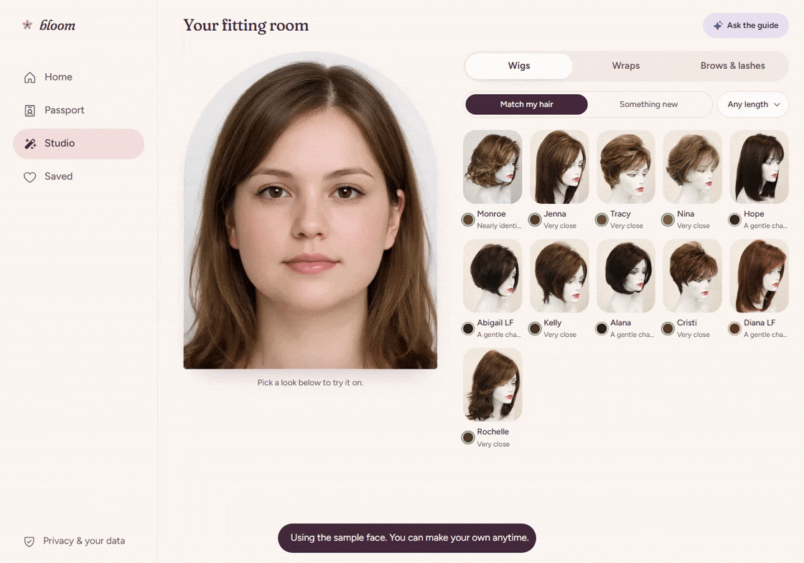
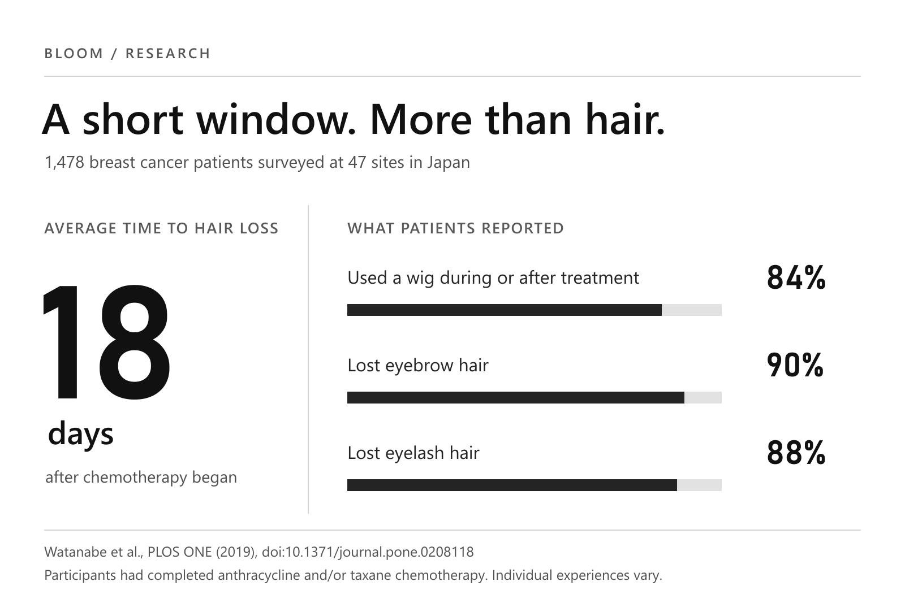
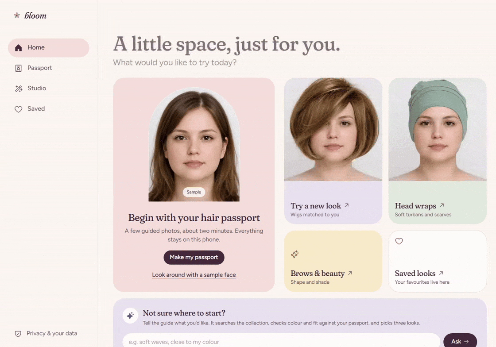
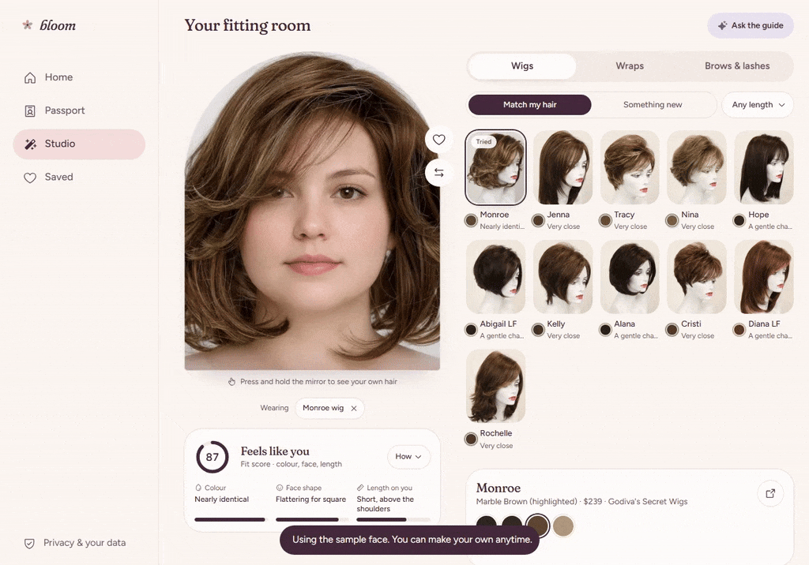
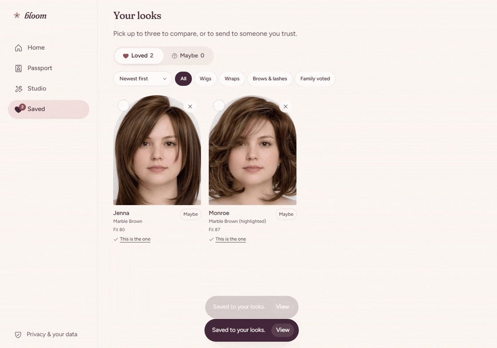
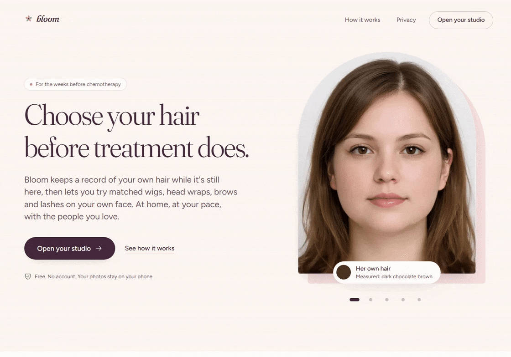
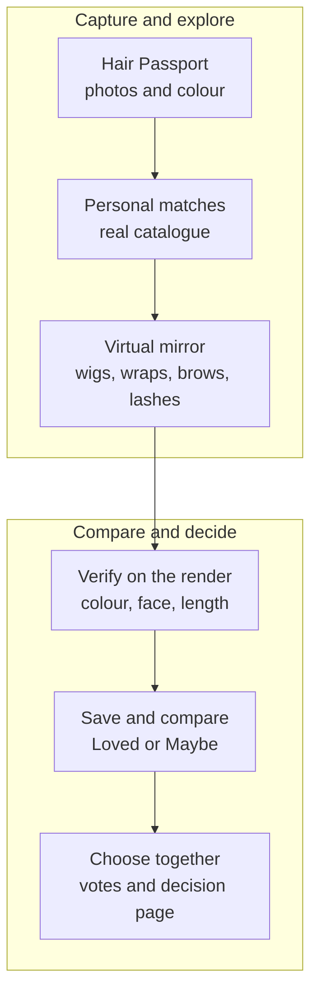
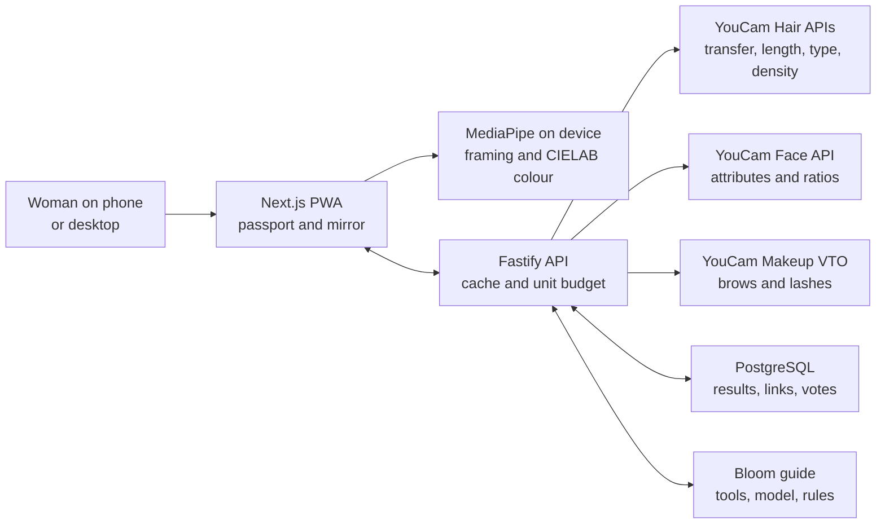

# Bloom: Choose your hair before treatment does

**“I did not know the stranger looking back at me from the mirror.”** [Renita shared those words with Macmillan Cancer Support](https://community.macmillan.org.uk/cancer-blogs/b/community_news/posts/i-did-not-know-the-stranger-looking-back-at-me-from-the-mirror--renita-s-hair-loss-story) after chemotherapy took her hair, eyebrows, and eyelashes. On Christmas Day, she wore a wig and drew on her brows to spend time with her family. For a few hours, she felt more like herself.

**Bloom gives women a way to prepare for moments like that.** It turns photos of natural hair into a **Hair Passport**, finds real wigs that resemble it, and lets someone try wigs, head wraps, brows, and lashes on her own face. Bloom then checks the finished image and helps her choose with people she trusts. The journey begins with **“this is my hair”** and ends with **“this is my choice.”**

**See Bloom in action.** This recording uses a sample face and pre-rendered YouCam results. Anyone can explore the experience without uploading a personal photo.

## Inspiration

- **A choice before hair loss.** [Writer Judith Harris described shopping for a wig with her sister and a hairstylist after her first chemotherapy session](https://washingtonian.com/2009/12/01/first-person-will-it-grow-back/). She still had her own hair as she tried to choose what might replace it. Her account showed us why personal reference photos, time to prepare, and the opinions of trusted people belong in one experience.

- **The options must reflect the person.** [Dianne Austin, a Black breast cancer survivor, could not find a wig that resembled her tightly coiled hair at hospitals near her home](https://blog.dana-farber.org/insight/2025/01/breast-cancer-survivor-provides-textured-wig-options-to-women-of-color/). She and her sister later founded a company offering textured wigs. Her experience made representation a specific priority for Bloom's catalogue expansion. A [review of 11 qualitative studies involving 225 women](https://pubmed.ncbi.nlm.nih.gov/36973593/) found that treatment-related hair loss can profoundly affect body image and identity.

- **A personal decision in a short window.** A wig, a wrap, or neither should be her choice. The [American Cancer Society recommends photographing current hair](https://www.cancer.org/cancer/side-effects/hair-skin-nails/hair-loss/choosing-and-wearing-wig.html) to help match a wig's style or colour, and [Breastcancer.org recommends preparing before treatment](https://www.breastcancer.org/treatment-side-effects/hair-loss/wigs) if a wig is something someone may want. Bloom turns those photos into a Hair Passport she can keep, use to find matches, and share with a wig fitter.

### The need in numbers

- **The preparation window can be short.** In a [survey of 1,478 breast cancer patients at 47 hospitals and clinics in Japan](https://journals.plos.org/plosone/article?id=10.1371%2Fjournal.pone.0208118), hair loss began an average of **18 days** after chemotherapy started. **84%** used a wig during or after treatment, **90%** lost eyebrow hair, and **88%** lost eyelash hair. The participants had received anthracycline and/or taxane chemotherapy; individual experiences vary.

- **The evidence shaped the product.** The preparation window led us to a quick capture flow. Wig use calls for a real catalogue and a fitting-room mirror. Eyebrow and eyelash loss explain why the experience covers the whole face. Bloom brings those choices together in a working sample journey judges can explore immediately.

## What it does

- **One connected journey.** A Hair Passport leads to real product matches, virtual try-ons, measured results, saved looks, family feedback, and a decision page. The recordings below show each part of the working browser experience.

- **Make a Hair Passport.** A guided camera or upload flow starts with a front photo; side and top photos are optional. MediaPipe checks framing and segments hair, then Bloom measures natural hair colour from those pixels on the device. YouCam adds face attributes and, when the relevant photos are available, hair length, type, and density. The passport names the source of each reading and leaves any unreadable field blank.

  

- **Find and try looks.** Bloom ranks catalogue wigs against the passport and uses YouCam to render a selected wig or head wrap on her photo. She can try brows and lashes over a wig or wrap, compare the result with her original photo, and save looks to **Loved** or **Maybe**.

- **Check the finished image.** The on-device process that measures natural hair colour also checks the completed try-on. Bloom uses **CIEDE2000 (ΔE00)** to quantify colour difference and explain how closely the result resembles her own hair. Its styling score weighs colour, face-shape guidance, and rendered length at **45% / 35% / 20%**.

  

- **Choose together.** She can compare saved looks, share up to three through a seven-day family link, and see **love it / not for me** votes. The link shows only the looks she selects. The Bloom guide searches the catalogue and compares saved looks using their layers, fit details, and family votes. When she chooses a wig, a printable decision page gathers its product details and practical insurance questions.

  

- **Explore without a camera.** A sample Hair Passport and pre-rendered YouCam try-ons let anyone explore the journey before sharing a personal photo.

  

### How Bloom handles personal photos

**The Hair Passport and saved looks are stored in the user's browser through IndexedDB.** MediaPipe handles framing and hair segmentation; Bloom calculates hair colour from those pixels on the device. When a user requests a YouCam analysis or virtual try-on, Bloom sends the selected image through its backend to YouCam for that operation. The backend manages tasks and caches reusable results; **PostgreSQL** stores results, family links, and votes. This design separates on-device measurements from cloud-based try-ons.

**Sharing requires a separate choice.** A family link displays only the looks the user selects, up to three. Anyone with the link can view those looks and vote during its **seven-day** lifetime. The Bloom guide receives passport facts, product details, and saved-look IDs, **not photographs**. Judges can explore the pre-rendered sample mode without a camera, account, or personal upload.

### The journey

## How we built it

- **Hair try-on and measurement.** **YouCam AI Hairstyle / Hair Transfer** renders wigs and wraps. **AI Hair Length Detection** reads the original photo and completed wig render. **AI Hair Type Detection** uses optional side photos, while **AI Hair Density Detection** uses an optional top photo.

- **Face and beauty try-on.** **YouCam AI Face Attributes & Ratio Analyzer** informs face-shape and brow guidance. **AI Makeup VTO** renders brows and lashes. Together, these six YouCam capabilities connect measurement, product selection, and the finished look.

- **Colour measured twice.** MediaPipe Tasks Vision checks face framing and segments hair in the browser. We convert hair pixels to **CIELAB**, calculate their median colour, and use **CIEDE2000** to compare shades. We measure the finished wig render as well. When available, the rendered colour replaces the product photo's colour in the fitting room's comparison.

- **A full stack built for the journey.** The interface is a **Next.js 16 / React 19** progressive web app. A **Fastify** API keeps YouCam credentials on the server, prepares images with **Sharp**, and starts and polls YouCam tasks. **PostgreSQL** stores reusable results, family links, and votes; browser **IndexedDB** stores the passport and saved looks. Caching and unit limits help manage API use.

- **A guide that can explain its choices.** The Bloom guide shows its steps as it reads the passport, searches the catalogue, checks fit, and compares saved looks. It can plan through **Groq** or **OpenRouter** and has a rules-based path when a model is unavailable. The guide receives facts and saved-look IDs, not photos. Bloom validates its suggestions against the catalogue and the user's preferences.

### The engineering path

## Challenges we ran into

- **Rendering headwear faithfully.** We tried YouCam's hair transfer, hat, and scarf routes with wigs and wraps. Hair transfer preserved the face and gave us the most faithful head-wrap result in Bloom's mirror, so we used it for both categories.

- **Explaining colour with evidence.** Product photos vary with lighting and backgrounds. We measured catalogue colours, then checked the finished render using the same scale as the Hair Passport. Bloom can explain how a shade appears **on the person**, rather than relying only on a product image.

- **Handling incomplete readings.** Optional photos leave some fields unmeasured, and an image can fail analysis. We track each result separately, give clear capture guidance, and explain when a field could not be read. The fitting room continues with the measurements that succeeded.

- **Managing API and model usage.** YouCam calls consume units, and model providers can throttle a multi-step guide. We cache identical renders, record unit use, pre-render the sample journey, validate model suggestions against deterministic tools, and provide a rules-based guide path.

## Accomplishments that we're proud of

- **An end-to-end product.** A woman can create a Hair Passport from her photo, find a matching product, see a YouCam render on her own face, check its colour and length, compare saved looks, invite family votes, and take a decision page to a wig fitter. These steps work together in the app and API. The catalogue contains **11 wig styles and 2 wrap styles across 51 variants**.

- **Engineering that supports a decision.** Bloom ranks real products, measures the finished preview, explains each match, and carries those details into comparison and purchase planning. Six YouCam capabilities work together with our colour analysis, catalogue data, and fit scoring to make the result useful beyond the first image.

- **A considerate interface.** The arched mirror carries the visual language of the landing page into the studio. Responsive layouts, guided capture, sample mode, comparison controls, and plain explanations make a sensitive decision easier to explore. Bloom is a cosmetic shopping aid and makes no diagnosis or treatment claim.

- **A working product judges can explore.** The personal-photo journey runs through the Next.js app, Fastify API, PostgreSQL, and live YouCam calls. A pre-rendered sample path makes the experience available immediately. Frontend and backend tests cover matching, API behaviour, sharing, and the main user journey.

## What we learned

- **A preview should support a decision.** A try-on becomes more useful when someone can compare it with her own hair, understand its colour and length, and find the product behind the image.

- **Personalisation needs clear sources.** We distinguish between what the device measured, what YouCam measured, and what a styling rule inferred. The guide uses a warm tone while grounding its numbers and product claims in those results.

- **Choice is the outcome.** One woman may want a familiar wig; another may prefer a wrap, a new style, or no head covering. Bloom gives each person room to decide what feels right for her.

## Why Bloom deserves first place

- **Bloom addresses every judging criterion.** The [official criteria weigh technology, design, potential impact, and quality of the idea equally](https://youcam-api-skin-ai-ecommerce.devpost.com/rules). Bloom brings six YouCam capabilities into a working product with original colour analysis, catalogue matching, and a coherent interface. Its purpose is grounded in the experiences women have shared about hair loss, identity, and choice.

- **Bloom carries the try-on through to a decision.** The Hair Passport starts with her own hair. Bloom uses it to find real products, checks the finished render, and helps her compare looks, hear from family, and choose. The result is a path from first photo to product details she can use when making a purchase.

- **Women in Tech.** **Nourin Richi leads our two-person team.** She identified the problem, conducted research, designed the UI/UX, shaped the project plan, helped finalise the architecture, and worked on documentation and video editing. **Ahammad Shawki** is Bloom's full-stack developer and AI engineer. Nourin's leadership shaped the product's human focus and the experience people use today.

- **Rising Star.** Both teammates are currently enrolled students. **Ahammad Shawki** studies at the **Bangladesh University of Engineering and Technology (BUET)** (`2305067@ugrad.buet.cse.ac.bd`), and **Nourin Richi** studies at **BRAC University** (`nourin.zaman.rachi@g.bracu.ac`). Together, they turned research and design into a working PWA, API, database, YouCam pipeline, colour analysis, and grounded guide.

## What's next for Bloom

- **The foundation is already working.** Bloom has a PWA, live YouCam pipeline, curated catalogue, matching logic, fitting room, family comparisons, and sample experience. Our next goal is to bring it to more people.

- **Use first prize to launch a public pilot.** The funding would support reliable hosting, YouCam usage, stronger controls for personal photos, and help for people using Bloom during treatment. We want to build a product women can rely on beyond the hackathon.

- **Expand who can see herself in the catalogue.** We plan to add more textured and coiled styles, colours, lengths, price points, cap designs, and headwear. We also want to work with wig makers and fitters so that a look someone likes in Bloom leads to a product she can obtain.

- **Build the next version with the people it serves.** We plan to invite women facing treatment, patient advocates, wig fitters, and cancer support organisations into the pilot. Their feedback will shape accessibility, photo guidance, privacy, and buying information before a wider launch. We want someone facing the moment Renita described to have choices she can explore and act on.

<!-- Devpost production note: Host docs/assets/bloom-evidence-poster.png and the five GIFs in docs/assets/devpost-gifs publicly, then replace their relative paths with hosted image URLs. Devpost's formatting guide says story images require external hosting: https://help.devpost.com/article/139-formatting-text-tips. Export both Mermaid diagrams as images before pasting into Devpost. Use a 3:2 landscape canvas (for example 1600 x 1067 px) and at least 20 px diagram text; check legibility at typical page width. Replace each Mermaid code block with its exported image because Devpost does not document native Mermaid rendering. -->
